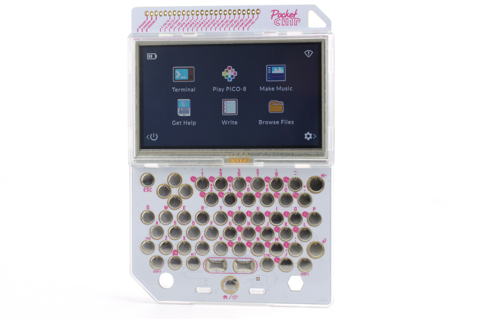
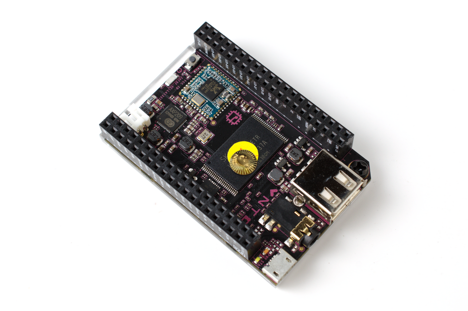

<p align="center">
  
</p>

# PocketCHIP Flasher

This is an easy to use, menu-driven re-flasher for the Next Thing Co. **PocketCHIP / C.H.I.P.**
Works on **Linux Mint / Ubuntu / Debian** and **Windows 10/11**.

This is a wrapper for the community [CHIP-tools-2025](https://github.com/Elfking29/CHIP-tools-2025) scripts that were kindly put together by Elfking29 under /CHIP-tools-2025.
Another great source that I didn't find till afterwards is [awesome-pocketchip](https://github.com/arran4/awesome-pocketchip) created by arran4 under /awesome-pocket chip that have a whole bunch of other sources in case you're interested.

Next Thing Co. shut down in 2018 and its download servers are gone which broke several other tools. **I built this software to make the Re-flashing process a breeze.** It gets the official images from a copy in this repo's [GitHub release](https://github.com/Mcstarcoin/PocketCHIP_re-flasher/releases/tag/images) or from the Internet Archive, checks them for validity, and then flashes them over USB.

<p align="center">
  
  
</p>
<p align="center"><sub>
  PocketCHIP and C.H.I.P. photos by <a href="https://www.flickr.com/people/120586634@N05">Gareth Halfacree</a>,
  <a href="https://creativecommons.org/licenses/by-sa/2.0/">CC BY-SA 2.0</a>, via
  <a href="https://commons.wikimedia.org/wiki/File:Next_Thing_CHIP_and_PocketCHIP_(29074994303).png">Wikimedia Commons</a>
  (<a href="https://commons.wikimedia.org/wiki/File:Next_Thing_CHIP_and_PocketCHIP_(29073142254).png">2</a>). Resized.
</sub></p>


> This is Unofficial community tool. Not affiliated with or endorsed by Next Thing Co.
> The Next Thing Co. name and logo belong to their owners and are shown only to
> identify the hardware this tool.


## How to run after install on Linux (Mint / Ubuntu / Debian)
Linux is the environment the tool was mostly designed for, and you might need a .venv setup if you have any issues getting a package to install in some rare cases.

```bash
chmod +x pocketchip-flasher.sh
./pocketchip-flasher.sh
```

Run it as your normal user, the tool only asks for sudo when needed.

## Windows 10 / 11

A. Download this repo (**Download ZIP**, then unzip it), or `git clone` it.
B. Open the `windows` folder and double-click **`PocketCHIP-Flasher.cmd`**.
 
1. First time only: choose **6 (Setup)**. It does three things:
   - downloads `fastboot.exe` (Google Android Platform-Tools)
   - builds `sunxi-fel.exe` from the official linux-sunxi source and can't run without this. There's no
     official windows build, so it downloads a portable compiler (~190 MB, nothing gets installed) and takes a few minutes.
   - opens **Zadig** to install the WinUSB driver. In Zadig, do this twice:
     *Device > Load Preset Device*, pick `chip-fel.cfg`, then `chip-fastboot.cfg`,
     and click **Install Driver** (WinUSB) each time. The CHIP doesn't need to be plugged in for this step.
2. Put the CHIP in FEL mode by connecting the Fel pin to GND (menu **1** explains how), plug it in, then choose **2 (FLASH NOW)** to start the process.

The Windows version runs natively and does the same FEL and fastboot steps as CHIP-tools-2025, 
they were just ported to ported to PowerShell because I firmly believe in easy to use software made free.

The menus, the bottom progress bar and the image caching work the same as on Linux too.
Everything it downloads on windows is kept in `%LOCALAPPDATA%\pocketchip-flasher` in case you need to go looking for it.

### Running it Command line Only (no menu):

Just in case you're a headless junky i've gone ahead (pun intended) and included a powershell only option.
This should also be useful if there's ever any issues with the Ui but let's hope that doesn't happen. 🤞 

```bash
powershell -ExecutionPolicy Bypass -File windows\pocketchip-flasher.ps1 -Flash -Yes -Flavor p
```

 , , `-Nand Hynix_8G_MLC|Toshiba_4G_MLC|Toshiba_512M_SLC`,

| The Options are:                                       | Note |
| ------------------------------------------------------ | ---- |
| `-Flavor p\|s\|g\|b`                                   |      |
| `-Branch stable\|testing`                              |      |
| `-Nand Hynix_8G_MLC\|Toshiba_4G_MLC\|Toshiba_512M_SLC` |      |

|`-Source auto|github|archive|mirror|local`|, `-LocalImage <zip or folder>`, `-NoLimit`, `-Reset`, `-DownloadOnly`.

## The Next Thing Co. firmware image

The default image is the last **stable PocketCHIP (Pocket OS)** release that
Next Thing Co. published:

| | |
|---|---|
| File | `stable-pocketchip-b126.zip` |
| Build | stable branch, PocketCHIP flavor, build 126 |
| Size | 1,013,156,421 bytes (~966 MB) |
| MD5 | `b529e97bbefb3fece7b54b1d5fc289d2` |
| SHA-1 | `7aaf3b03bcf66fdb869024e5dc356740391ab514` |
| Download (GitHub copy) | [releases/download/images/stable-pocketchip-b126.zip](https://github.com/Mcstarcoin/PocketCHIP_re-flasher/releases/download/images/stable-pocketchip-b126.zip) |
| Download (Internet Archive) | [archive.org/download/C.h.i.p.FlashCollection/stable-pocketchip-b126.zip](https://archive.org/download/C.h.i.p.FlashCollection/stable-pocketchip-b126.zip) |

The flasher detects the NAND chip and picks the matching files.

The zip holds the files for every NAND type as a backup. 

Other official builds are in the Internet Archive's [C.H.I.P. Flash Collection](https://archive.org/details/C.h.i.p.FlashCollection).

Choose them under **Advanced > Flavour / Branch**: 
^(YEA I know this is spelled weird, just wanted to leave it the way it was under Elfking29's build)

| Flavor | Stable | Testing |
|---|---|---|
| PocketCHIP (Pocket OS) | `stable-pocketchip-b126.zip` | `testing-pocketchip-b667.zip` |
| GUI (Debian + XFCE) | `stable-gui-b149.zip` | `testing-gui-b543.zip` |
| Server (headless Debian) | `stable-server-b149.zip` | `testing-server-b543.zip` |
| Buildroot (minimal) | `stable-buildroot-b34.zip` | `testing-buildroot-b23.zip` |

Download order when the source is **Auto**: an already-downloaded copy, then the
GitHub release, then the Internet Archive, then the old jfpossibilities mirror
(offline since 2026). Every download is MD5-checked against the Internet Archive's
file list. If you downloaded a zip yourself, use **Advanced > Image source > Local**.

These images are Next Thing Co.'s original, unmodified builds, copied here so
they're easier to find since Next Thing Co. no longer exists. The images contain
Debian and other open-source software under their own licenses.

## Testing without a CHIP

- Linux: `tests/run-dry-flash.sh`
- Windows: `powershell -ExecutionPolicy Bypass -File windows\tests\run-dry-flash.ps1`

Both should print `PASS`. They use fake USB tools and a small fake image.
